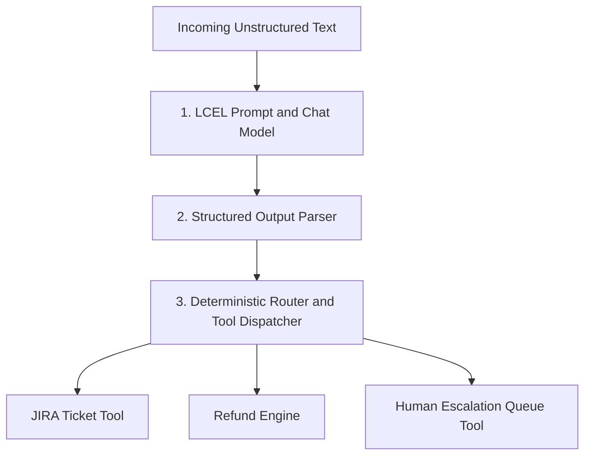

# Structured Intent Extractor & Automated Tool Router Agent

An enterprise-grade intent classification and tool-routing system built using **LangChain Expression Language (LCEL)**, **Pydantic v2 runtime validation**, and **NVIDIA NIM microservices** (`nvidia/nemotron-3-super-120b-a12b`).

This system addresses a core production AI engineering challenge: converting unstructured, unpredictable human messages into **guaranteed JSON payloads** and deterministically routing parameters to backend Python tools without executing unvalidated model actions directly.

## Key Features

- **LangChain Expression Language (LCEL) Architecture:** Built on modern LCEL pipelines (`prompt | structured_llm`) for declarative chain composition.
- **Guaranteed Pydantic Schemas:** Utilizes `.with_structured_output()` to force LLM responses into strict Python Pydantic models (`ProcessedTicket`), complete with string `Enum` boundaries (`ActionCategory`, `PriorityLevel`).
- **Deterministic Decision Layer:** Decouples LLM intelligence from backend code execution—the model extracts and classifies parameters while deterministic Python code safely executes backend tools.
- **LangChain Tool Integration:** Uses the `@tool` decorator framework to register typed, docstring-documented backend functions for JIRA ticket creation, automated refund processing, and human support escalation.
- **Package & Environment Management:** Managed with `uv` for reproducible virtual environments and dependency locking.

## System Architecture



| Stage | Details |
| --- | --- |
| **1. LCEL Prompt & Chat Model (`router_engine.py`)** | LangChain `ChatOpenAI` pointing to the NVIDIA NIM API. Uses `nvidia/nemotron-3-super-120b-a12b` with `temperature=0.0` for deterministic classification. |
| **2. Structured Output Parser (`.with_structured_output()`)** | Enforces the `ProcessedTicket` Pydantic schema and validates category and priority level enums. |
| **3. Deterministic Router & Tool Dispatcher** | Evaluates ticket priority and human escalation, then matches `ActionCategory` to registered tools. |
| **Backend Tools (`tools.py`)** | JIRA ticket creation, refund processing, and human escalation queue handlers. |

## Tech Stack

| Component | Technology | Role |
| --- | --- | --- |
| Orchestration Framework | LangChain (`langchain-core`, `langchain-openai`) | Chain construction via LCEL and structured model bindings. |
| LLM Provider | NVIDIA NIM API | Hosted `nvidia/nemotron-3-super-120b-a12b` model. |
| Data Validation | Pydantic v2 & Python Enums | Schema enforcement, parameter extraction, and type safety. |
| Environment Management | `uv` | Dependency resolution and virtual environment isolation. |

## Repository Structure

```text
Intent_Router_Agent/
├── .env                 # API keys (NVIDIA_NIM_API_KEY)
├── pyproject.toml       # Package dependencies & uv configuration
├── uv.lock              # Locked dependency tree
├── schemas.py           # Pydantic models & Enum classifications
├── tools.py             # LangChain @tool decorated execution functions
├── router_engine.py     # LCEL pipeline & dispatch router controller
└── README.md            # Technical showcase documentation
```

## Installation & Setup

### 1. Prerequisites

- Python 3.11+
- `uv` package manager
- NVIDIA NIM API key

### 2. Project Initialization

Clone the repository and sync dependencies using `uv`:

```bash
git clone https://github.com/YOUR_USERNAME/Intent_Router_Agent.git
cd Intent_Router_Agent
uv sync
```

### 3. Environment Configuration

Create a `.env` file in the root directory:

```dotenv
NVIDIA_NIM_API_KEY="nvapi-your-actual-api-key-here"
```

## Module Breakdown

### 1. `schemas.py` — Data Models & Enums

Defines strict classification choices and output models using Pydantic:

- **`PriorityLevel` Enum:** Restricts urgency choices to `LOW`, `MEDIUM`, `HIGH`, or `CRITICAL`.
- **`ActionCategory` Enum:** Categorizes intents into `BUG_REPORT`, `FEATURE_REQUEST`, `BILLING_ISSUE`, or `GENERAL_INQUIRY`.
- **`ProcessedTicket` Model:** The unified schema returned by the LLM containing extracted entities, including `customer_id`, `summary`, and `requires_human_escalation`.

### 2. `tools.py` — Backend Execution Functions

Implements executable tool handlers wrapped with LangChain's `@tool` decorator:

- **`create_jira_ticket`:** Generates bug tickets with assigned priorities.
- **`process_customer_refund`:** Initiates refund workflows given a validated `customer_id`.
- **`escalate_to_human_agent`:** Bypasses automation to route critical emergencies to human support queues.

### 3. `router_engine.py` — LCEL Pipeline & Dispatcher

- Instantiates `ChatOpenAI` bound to the NVIDIA NIM endpoint.
- Constructs the LCEL chain (`prompt | structured_llm`) with system rules prohibiting ungrounded speculation.
- Parses incoming user messages, prints the structured Pydantic payload, and invokes backend tools.

## Usage & Execution

Run the router engine using `uv`:

```bash
uv run python router_engine.py
```

## Example Execution Logs

### Scenario 1: Bug Report

```text
--- Processing Incoming Message ---
"The dark mode toggle button on the settings page has a small alignment typo. User ID: CUST_404."

--- Extracted Pydantic Form Output ---
Category           : BUG_REPORT
Priority           : LOW
Summary            : The dark mode toggle button on the settings page has an alignment typo.
Customer ID        : CUST_404
Human Escalation   : False

--- Backend Tool Result ---
[MOCK JIRA API] Created Issue Ticket successfully -> Summary: 'The dark mode toggle button on the settings page has an alignment typo.' | Priority: LOW
```

### Scenario 2: Critical Financial Refund & Human Escalation

```text
--- Processing Incoming Message ---
"CRITICAL: I was charged $500 twice on my account today! Need a refund right now!"

--- Extracted Pydantic Form Output ---
Category           : BILLING_ISSUE
Priority           : CRITICAL
Summary            : Customer reports being charged $500 twice today and requests an immediate refund.
Customer ID        : None
Human Escalation   : True

--- Backend Tool Result ---
[MOCK SUPPORT QUEUE] Escalated to senior support agent -> User: UNKNOWN_USER | Issue: 'Customer reports being charged $500 twice today and requests an immediate refund.'
```
