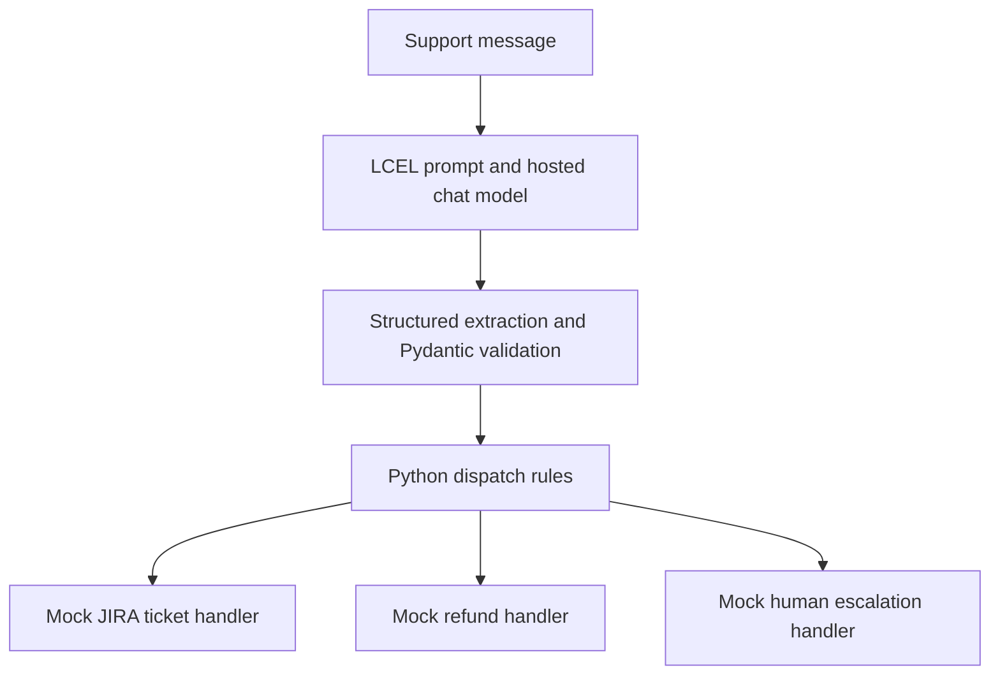

# Structured Intent Extractor and Tool Router

A Python prototype that converts unstructured support messages into typed ticket data and routes the validated result to a mock backend handler.

The project uses LangChain Expression Language (LCEL), Pydantic v2, Python enums, and a hosted NVIDIA NIM model. The LLM classifies and extracts information; Python rules decide which handler to execute. This is a bounded routing workflow rather than an autonomous planning agent.

## Features

- **Intent classification:** Categorizes messages as bug reports, feature requests, billing issues, or general inquiries.
- **Structured extraction:** Requests ticket fields through `.with_structured_output()` and a `ProcessedTicket` Pydantic model.
- **Constrained categories:** Uses enums for supported action categories and priority levels.
- **Rule-based dispatch:** Separates model-generated ticket data from backend handler selection.
- **Human escalation:** Demonstrates routing a critical issue to a human-support handler.
- **Mock tools:** Includes simulated ticket creation, refund processing, and human escalation through LangChain `@tool` functions.
- **Dependency management:** Uses `uv`, `pyproject.toml`, and `uv.lock`.

## Architecture



The Python dispatch rules are deterministic for a given validated ticket. The model's classification and extracted values can vary or be incorrect, so the end-to-end workflow is not guaranteed to produce identical or correct decisions on every run.

## Tech stack

| Component | Technology | Purpose |
| --- | --- | --- |
| Language | Python 3.11+ | Schemas and routing logic |
| Orchestration | `langchain-core`, `langchain-openai` | Prompt composition and chat model integration |
| Validation | Pydantic v2 and Python enums | Typed ticket fields and allowed values |
| Inference provider | NVIDIA NIM | Hosted model access |
| Model | `nvidia/nemotron-3-super-120b-a12b` | Classification and information extraction |
| Environment | `uv` | Dependency synchronization and execution |

## Repository structure

```text
Intent_Router_Agent/
├── pyproject.toml       # Project dependencies and configuration
├── uv.lock              # Dependency lockfile
├── schemas.py           # Ticket model and enums
├── tools.py             # Mock backend handlers using @tool
├── router_engine.py     # LCEL pipeline and Python dispatch
└── README.md
```

Create a local `.env` file for credentials and exclude it from version control.

## Setup

Install `uv` and ensure Python 3.11 or later is available. From the project directory, synchronize the environment:

```bash
uv sync
```

Create a local `.env` file:

```dotenv
NVIDIA_NIM_API_KEY=your-api-key
```

The configured NVIDIA NIM endpoint must support the selected model and the structured-output method used by the implementation. An OpenAI-compatible endpoint does not necessarily support every OpenAI feature. API access, model availability, and charges depend on the provider and account.

Run the demonstration:

```bash
uv run python router_engine.py
```

## Module details

### `schemas.py`

Defines the ticket schema and allowed classification values:

| Definition | Values or fields described by the project |
| --- | --- |
| `PriorityLevel` | `LOW`, `MEDIUM`, `HIGH`, `CRITICAL` |
| `ActionCategory` | `BUG_REPORT`, `FEATURE_REQUEST`, `BILLING_ISSUE`, `GENERAL_INQUIRY` |
| `ProcessedTicket` | Category, priority, summary, customer ID, and human escalation requirement |

The documented example represents a missing customer ID as `None`. A model should not invent an identifier to fill a missing field.

Pydantic validates data against the declared schema. This does not verify a customer's identity, prove a complaint is accurate, or authorize an action. Type coercion and strictness depend on the model configuration; using Pydantic alone does not imply strict-mode validation.

### `tools.py`

Defines typed functions with docstrings and LangChain's `@tool` decorator:

| Handler | Demonstrated behavior |
| --- | --- |
| `create_jira_ticket` | Simulates ticket creation using a summary and priority |
| `process_customer_refund` | Simulates a refund workflow using a customer ID |
| `escalate_to_human_agent` | Simulates sending an issue to a human-support queue |

These handlers are mocks. Their output does not establish a connection to JIRA, a payment provider, or a live support queue. The `@tool` decorator exposes a callable tool interface; it does not provide authorization or transaction safeguards.

### `router_engine.py`

1. Configures `ChatOpenAI` for the NVIDIA NIM endpoint.
2. Composes the extraction chain with `prompt | structured_llm`.
3. Requests and parses ticket data using the declared Pydantic schema.
4. Applies escalation and category rules to the resulting ticket.
5. Invokes the selected mock handler and prints its result.

The configured `temperature=0.0` reduces sampling randomness rather than guaranteeing repeatable classification. Schema or parsing failures must be handled before dispatch; successful validation does not establish semantic correctness.

## Illustrative scenarios

### Low-priority bug report

```text
Message: The dark mode toggle on the settings page is misaligned. User ID: CUST_404.

Example extracted fields:
Category: BUG_REPORT
Priority: LOW
Customer ID: CUST_404
Human escalation: False

Example action: Invoke the mock JIRA ticket handler.
```

### Critical billing complaint with no customer ID

```text
Message: CRITICAL: I was charged $500 twice today! I need help immediately.

Example extracted fields:
Category: BILLING_ISSUE
Priority: CRITICAL
Customer ID: None
Human escalation: True

Example action: Invoke the mock human escalation handler.
```

These illustrate the documented workflow, not guaranteed outputs for every model invocation. The second example demonstrates escalation rather than completion of a refund.

## Limitations and evaluation

- **Structured output can fail.** Provider support, parsing, schema validation, and API requests can produce errors. This documentation does not establish retry or recovery behavior.
- **Valid fields can still be wrong.** A ticket can satisfy the schema while containing an incorrect category, priority, or extracted identifier.
- **Routing rules need complete coverage.** Four categories are defined, but the examples do not establish the behavior of every category, missing-field case, or unsupported input.
- **Escalation depends on extraction.** A model can miss urgency or accept misleading instructions. Prompt instructions alone do not establish robust resistance to prompt injection.
- **The tools are simulated.** Real actions would require authentication, authorization, business-rule checks, audit records, and duplicate-action protection. A customer ID alone is insufficient authorization for a refund.
- **No measured accuracy is reported.** The demonstration examples are not a classification benchmark or evidence of production readiness.

Useful next steps include labeled classification tests, missing-field and invalid-output tests, explicit fallback routes, API error handling, and tests that verify critical issues reach human review. These are proposed improvements, not claimed implemented features.
